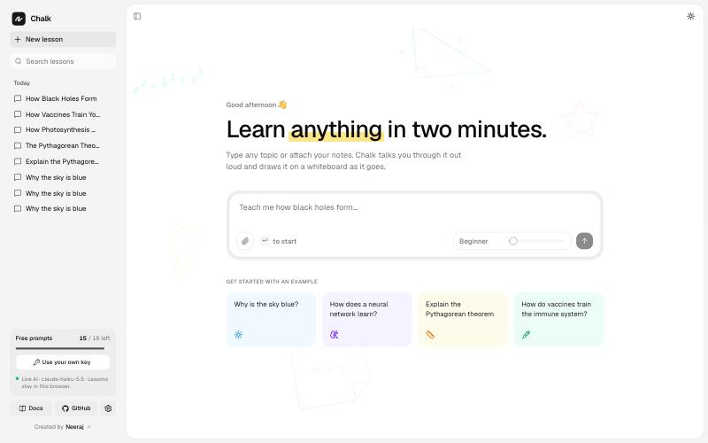
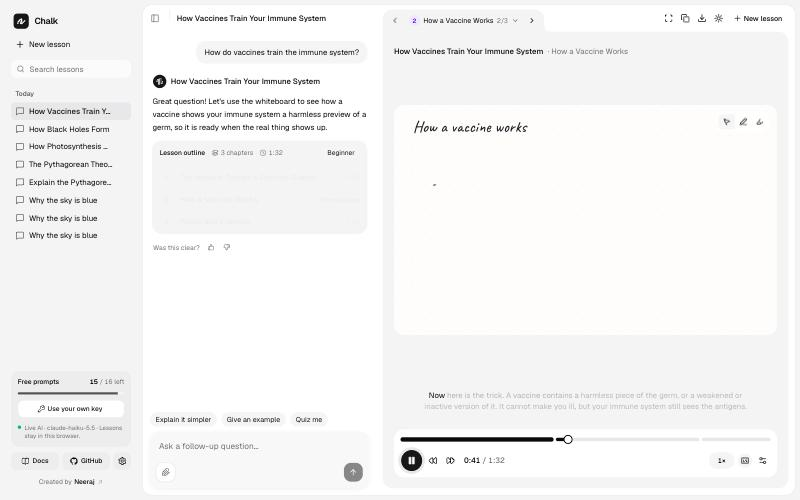

# Chalk — an AI whiteboard tutor

Created by [Neeraj](https://www.itsneeraj.com/) · [MIT licensed](LICENSE) · [Documentation](https://github.com/NEER4J/ai-whiteboard-tutor#readme)

Type any topic and Chalk teaches it the way a good teacher does at a whiteboard:
it **talks you through it while drawing**, building a diagram up piece by piece in
sync with its voice. A lesson is about two minutes long. You can pause, scrub,
jump between chapters, click anything on the board to ask about it, draw your own
notes on top, and ask follow-up questions that get answered **on the board**, not
just in text.

> **Live demo: https://chalk.itsneeraj.com/** · [Documentation](https://chalk.itsneeraj.com/docs) · Built with Next.js 16, shadcn/ui (Base UI) and the Vercel AI SDK + AI Gateway.




---

## The learner and the problem

**Who:** a curious self-learner (a student before an exam, or an adult who keeps
hearing a term they don't really understand) who wants the *intuition* for one
concept quickly.

**Problem:** text answers from chatbots are walls of prose. Videos are good but
fixed: you can't ask the video a question, and the one you find is either too
long, too basic or too advanced. The thing that works in real life is a person
explaining *and drawing at the same time*, and stopping when you look confused.

**What Chalk does about it**

| Need | How Chalk handles it |
| --- | --- |
| See the idea, not just read it | Every lesson is a sequence of hand-drawn diagrams built up step by step |
| Hear it explained | Narration is spoken by an AI voice; captions highlight each spoken word |
| Visuals that match the words | Each drawing is tied to a phrase in the narration and appears when that phrase is spoken |
| Right level | A Beginner → Advanced slider changes vocabulary, depth and math |
| Control the pace | Play, pause, resume, seek, restart, chapter jumps, 0.75–1.5x speed, keyboard shortcuts |
| Ask "wait, what?" | Follow-ups use the lesson, the moment you paused at and the chat history, and answer with a short narrated board |
| Check understanding | "Quiz me" asks one question; your reply is graded with an explanation |
| Point at the confusing bit | Click any drawing to pre-fill "Can you explain *X* in more detail?" |
| Think with your hands | Pen and highlighter tools to annotate any board (per board, per clip) |
| Learn from your own notes | The paperclip on the home screen attaches up to 3 files (text/markdown/CSV/JSON, PDF, or images; 3 MB total). The model teaches from them; text is inlined, PDFs and images are sent as multimodal input. You can also paste files or screenshots (Ctrl/Cmd+V) into either prompt box and attach to follow-up questions. Attachments are used only in live mode |
| Come back later | Every lesson has its own URL (`/lesson/<id>`), so a reload or the back button returns to it. A sidebar keeps your lesson history (search, reopen, delete) in this browser's localStorage, so past lessons replay without calling the AI again |

## Access for reviewers

- **Open https://chalk.itsneeraj.com/** in any modern browser. No sign-up and no setup.
- The demo runs on live AI (GPT-6.1 Terra for lessons, Gemini TTS for the voice). Each visitor gets **10 free prompts per day**
  (a lesson, a follow-up, a quiz answer or a hint each count as one). Limits reset at midnight UTC; the sidebar shows how many are left today.
- If you use them all, either come back later or **add your own Vercel AI Gateway key** (sidebar → *Use your own key*). It stays in your
  browser and is never stored by the server.
- If the live AI is ever unavailable, the app falls back to a clearly labelled **sample mode** with one pre-written lesson, so the
  interface can still be explored.
- Everything also runs locally in a few minutes: see [Running locally](#running-locally).

| Evaluation dimension | Where to look |
| --- | --- |
| Product understanding and problem framing | [The learner and the problem](#the-learner-and-the-problem) |
| Originality and product thinking | Voice-synced hand-drawn board, click-to-ask, quiz with inline answers, chapter timeline, attachments |
| Engineering and problem-solving | [Key decisions](#key-decisions), streaming, cue-based sync, quota and caching design |
| AI integration and application | [What is live and what is not](#what-is-live-and-what-is-not), structured output, guardrails, declines small talk |
| Teaching and interaction quality | [How to explore it](#how-to-explore-it-reviewer-guide) |
| Code quality and technical decisions | Typed schema, 44 unit tests (`npm test`), CI, lint and typecheck clean |
| Documentation and communication | This README and the in-app [/docs](https://chalk.itsneeraj.com/docs) page |

## How to explore it (reviewer guide)

1. Open the demo, pick a level, and enter a topic, or click a suggestion.
2. The lesson starts playing after the first part is generated (a few seconds);
   the rest is generated while you watch (the faded part of the timeline).
3. Try **pause / resume** (Space), **seek** (drag the bar or ← / →), **restart** (R),
   **chapters** in the chat panel, **speed**, and **captions** (C).
4. Pause on a diagram and **click a drawing**, then send the pre-filled question.
5. Use the quick actions: **Explain it simpler**, **Give an example**, **Quiz me**.
   Answer the quiz in the chat.
6. Follow-up answers play on their own board; **Back to lesson** returns you to
   where you were.
7. Grab the **pen / highlighter** in the board's top-right corner and mark things up.

## What is live and what is not

| Part | Status |
| --- | --- |
| Lesson generation (narration + diagrams) | **Live** — `openai/gpt-6.1-terra` with thinking off, via Vercel AI Gateway, streamed |
| Follow-up answers, quizzes, grading | **Live** — same model, with lesson + position + chat history as context |
| Narration voice | **Live** — `google/gemini-3.8-flash-lite-tts` via AI Gateway (one clip per segment) |
| Voice fallback | Browser `speechSynthesis` (local, not AI) if AI speech fails, or if you choose it with the voice button |
| Home chat | **Live** — talk to Chalk on the home screen (`/api/chat`). The model decides with a `create_lesson` tool whether to answer in text or start a lesson; chat has its own daily caps (`CHAT_PER_IP_DAY`, `GLOBAL_DAILY_CHAT`) and does not use up lesson prompts |
| Custom drawings | The model is not limited to stock shapes: the `sketch` element lets it draw its own illustrations from SVG-path strokes, which are roughened and animated like everything else |
| Export as video | Client-side: the board is rendered frame by frame on a canvas, narration is mixed with Web Audio and captured by `MediaRecorder` (MP4/WebM). Runs in the background with a progress ring in the header; nothing is uploaded. Records in real time, so keep the tab open |
| Hand-drawn rendering, animation, sync | Deterministic client code (rough.js + SVG), no AI at render time |
| **Sample mode** | If the server has **no AI credentials**, the header shows "Sample mode", every topic plays one **pre-written** lesson ("Why is the sky blue?"), follow-ups return a placeholder, and the browser voice narrates. Nothing in sample mode is presented as AI output. |

## Architecture

```
┌──────────── Browser ─────────────────────────────────────────────┐
│ Chat panel (shadcn message / bubble / input-group)               │
│   │ topic / question                                             │
│   ▼                                                              │
│ streamClip() ── POST /api/lesson ──► partial JSON (streamed)     │
│   │ parsePartialJson → normalize → complete segments only        │
│   ▼                                                              │
│ Player (clock)  ◄── voice engine: AiVoice (mp3 from /api/tts)     │
│   │  time              or BrowserVoice (speechSynthesis)         │
│   ▼                                                              │
│ buildTimeline(segments, measured durations) → visibleAt(time)    │
│   ▼                                                              │
│ Whiteboard (SVG): rough.js strokes drawn by stroke-dashoffset    │
└──────────────────────────────────────────────────────────────────┘
Server (Next.js route handlers)
  /api/lesson  streamText + Output.object(zod clip schema) → AI Gateway
  /api/tts     generateSpeech(gateway.speech(TTS_MODEL)) → audio
  /api/status  live vs sample mode for the UI badge
```

### Key decisions

**1. The lesson is data, not a video.** The model returns a typed `Clip`:
`segments[]`, each with 1–3 sentences of `narration` and the `elements` drawn
during it (`text`, `line`, `arrow`, `curve`, `rect`, `circle`, `ellipse`, `path`, `axes`, `bars`, `brace`, `note`, `icon` (24 hand-drawn icons), `highlight`)
on a fixed 1000×600 board ([`src/lib/schema.ts`](src/lib/schema.ts)). Because it
is structured, everything (seeking, chapters, captions, clicking on drawings,
follow-up context) works on it directly, and output is checked with zod
before use.

**2. Sync through cue phrases.** Asking a model for timestamps doesn't work, because
it can't know how long TTS will take. Instead every element carries a `cue`: a
short phrase quoted from its segment's narration. On the client, the cue's position
in the text becomes a fraction of the segment, which is multiplied by the
segment's **measured audio duration** ([`src/lib/timeline.ts`](src/lib/timeline.ts)).
Audio is generated **per segment**, so any timing error is limited to one segment
(a few seconds) and resets at the next one. If a cue can't be found, elements fall
back to an even spread across the segment.

**3. The board is a pure function of time.** `visibleAt(timeline, t)` returns
each visible element with a 0..1 draw progress. Play, pause, seek and restart are
therefore just "set t, then (re)start narration for the segment containing t"
([`src/lib/player.ts`](src/lib/player.ts)), which keeps the state machine small
and makes seeking exact. The `Player` lives outside React and is read through
`useSyncExternalStore`.

**4. Stream so the lesson starts quickly.** A full lesson is about 3–5k tokens of
JSON. The route streams raw JSON text; the client parses it as partial JSON and
treats a segment as playable once the next one has started. Playback starts after
the first segment, and if it catches up with generation it shows "Writing the next
part…" and resumes by itself. Narration audio is prefetched three segments at a
time, nearest first.

**5. Two voice engines behind one interface** ([`src/lib/voice.ts`](src/lib/voice.ts)).
AI speech gives natural audio with exact durations and precise seeking. Browser
speech costs nothing and works without a key; its timing is estimated and
corrected with word-boundary events, and it speaks sentence by sentence to work
around Chrome cutting off long utterances. If AI voice fails, the player
switches engines on its own and tells the learner.

**6. Defending against model output.** Each element is validated on its own
(invalid ones are dropped, not the whole lesson), coordinates are clamped to the
board, long text is wrapped to the board width, and highlights only target ids
already on the current board. The prompts include a layout guide (safe areas,
font metrics, a three-zone layout) because overlapping layouts were the most
common failure ([`src/lib/prompts.ts`](src/lib/prompts.ts)).

**7. Handling uncertainty and failure.** Prompts tell the tutor to say when it is
unsure, to pick and name a meaning for ambiguous topics, and to decline harmful
requests in-lesson. Errors in the stream are turned into readable messages
("credentials rejected", "busy / out of credits") with **Try again**, and a stop
button cancels generation.

**8. Clean UI.** shadcn/ui on Base UI, using the AI Elements chat building blocks
(`message-scroller`, `message`, `bubble`, `input-group`), with very few borders or
shadows; the dotted board is the main visual. Light/dark follow the system,
including a "chalkboard" palette for the board in dark mode.

### Project layout

```
src/
  app/api/lesson/route.ts   streamed lesson / follow-up generation
  app/api/tts/route.ts      narration audio
  app/api/status/route.ts   live vs sample mode
  lib/schema.ts             zod schema for clips, segments, board elements
  lib/prompts.ts            system prompts (lesson, follow-up, board guide)
  lib/timeline.ts           cue → time mapping, visibleAt, captions helpers
  lib/player.ts             playback clock / transport state machine
  lib/voice.ts              AiVoice + BrowserVoice engines
  lib/stream-clip.ts        streaming client + output normalization
  lib/server/               config, rate limiting, sample-mode content
  components/whiteboard/    SVG renderer + rough.js shape builder
  components/tutor/         app shell, chat panel, board stage, controls
```

## Running locally

Requirements: Node 20+ and npm.

```bash
npm install
cp .env.example .env.local   # add AI_GATEWAY_API_KEY to use live AI
npm run dev                  # http://localhost:3000
```

Without a key the app runs in **sample mode** (see above), so the UI and
playback can be tried with no credentials.

### Environment variables

| Name | Required | Example | Purpose |
| --- | --- | --- | --- |
| `AI_GATEWAY_API_KEY` | for live AI (not needed on Vercel with OIDC) | `vck_xxx` | Vercel AI Gateway key |
| `LESSON_MODEL` | no | `openai/gpt-6.1-terra` | Text model for lessons and follow-ups (any gateway model id; `deepseek/deepseek-v4.1-flash-1017` is a faster, cheaper alternative) |
| `LESSON_PROVIDER` | no | the model maker (`openai`) | Gateway provider to pin the model to; `any` lets the gateway choose |
| `CHAT_PER_IP_DAY` / `GLOBAL_DAILY_CHAT` | no | `40` / `400` | Daily caps on home-chat messages per IP and across everyone |
| `LESSON_REASONING` | no | `none` | Thinking effort: `none` (fastest), `minimal`, `low`, `medium`, `high` |
| `TTS_MODEL` | no | `google/gemini-3.8-flash-lite-tts` | Speech model for narration (e.g. `openai/tts-1`, `fish-audio/drama-3`) |
| `TTS_VOICE` | no | `Kore` | Voice name for the speech model (provider-specific; `nova` for OpenAI) |
| `FREE_PROMPTS` | no | `10` | Free prompts per visitor (lessons, follow-ups, quiz answers and hints all count) before they must add their own key |
| `FREE_PER_IP_DAY` / `GLOBAL_DAILY_PROMPTS` | no | `10` / `50` | Per-IP and whole-demo daily caps on free prompts |
| `TTS_PER_IP_DAY` / `GLOBAL_DAILY_TTS` | no | `320` / `800` | Same for narration clips |
| `UPSTASH_REDIS_REST_URL` / `_TOKEN` | recommended in production | from the Upstash integration | Shared counters (also accepted as `KV_REST_API_URL` / `KV_REST_API_TOKEN`) |
| `USAGE_SECRET` | recommended in production | any long random string | Signs the usage cookie (falls back to the gateway key) |
| `NEXT_PUBLIC_SITE_URL` | recommended once you have a domain | `https://chalk.example.com` | Public origin for canonical, social preview and sitemap URLs (on Vercel the production URL is used automatically) |
| `MOCK_AI` | no | `1` | Force sample mode |

### Deploying

Deploy to Vercel (`vercel deploy` or import the repo). Add `AI_GATEWAY_API_KEY`
in Project → Settings → Environment Variables, or turn on AI Gateway for the
project to use OIDC authentication. `/api/lesson` declares `maxDuration = 120`
for long generations.

## Cost

A two-minute lesson is roughly 1,800 characters of narration. Approximate list prices through AI Gateway:

| Part | Model | Per lesson |
| --- | --- | --- |
| Narration (default) | `google/gemini-3.8-flash-lite-tts` | about $0.017 |
| Narration (alternative) | `fish-audio/drama-3` | about $0.018 |
| Narration (previous default) | `openai/tts-1` | about $0.027 |
| Lesson text | `openai/gpt-6.1-terra`, thinking off | about $0.03–0.06 |

Narration is requested once per segment and cached for the tab, so replaying, seeking and restarting cost nothing extra; reopening a saved lesson later re-requests the audio.

## Docs, SEO and sharing

- **In-app documentation** lives at `/docs` (linked from the sidebar next to the GitHub link): usage, shortcuts, free limits and your own key, how it works, privacy and self-hosting.
- **SEO:** page titles and descriptions, canonical URLs, Open Graph and Twitter cards, a generated 1200x630 preview image (`/og`), favicon, Apple touch icon, web manifest, `robots.txt`, `sitemap.xml` and JSON-LD structured data. Individual lesson pages (`/lesson/<id>`) are `noindex` because they live in the visitor's browser.

## Limits, caching and bring-your-own-key

The demo runs on one shared AI Gateway key, so spending is capped in layers:

| Layer | Limit | Survives incognito / cleared cookies? |
| --- | --- | --- |
| Per browser (signed HttpOnly cookie) | **10 free prompts per day**: a lesson, follow-up, quiz answer or hint each cost one | No (it is the friendly, visible limit) |
| Per IP address (hashed, never stored raw) | **10 prompts per day** in total, 320 voice clips per day | **Yes** |
| Whole demo (circuit breaker) | 50 prompts per day and 800 voice clips per day, across all visitors | **Yes** |
| Short burst limit | 30 requests / 10 min per IP | Yes |

Past a limit, the app explains why and offers to **use your own Vercel AI Gateway key** (sidebar → *Use your own key*). The key is
verified with a one-word request, kept only in the visitor's browser, and sent in an `x-chalk-key` header so the server can call the
gateway on their account. It is never stored or logged, and it bypasses the free limits (they pay for their own usage).

Counters for the per-IP and global layers live in **Upstash Redis / Vercel KV** when `UPSTASH_REDIS_REST_URL` + `UPSTASH_REDIS_REST_TOKEN`
(or `KV_REST_API_URL` + `KV_REST_API_TOKEN`, with or without a custom prefix such as `STORAGE_`) are set, so every serverless instance sees the same numbers. Without it they fall back to
in-memory counters, which is fine locally but only a partial safeguard on serverless. For a hard guarantee also set a spend budget on the
AI Gateway key itself.

**Nothing is generated twice.** Lessons and chat are saved in the browser's localStorage. Narration audio is saved in IndexedDB, keyed by
voice model + exact text, so replaying, reloading or reopening a lesson makes no AI calls at all. Asking for a topic you already have
(same level) reopens the saved lesson instead of generating it again, and costs no prompt.

## Limitations and what I'd do next

- **Layout is model-planned.** The prompt and clamping prevent most problems,
  but labels can still overlap on busy boards. Next step: a small layout pass
  that detects overlapping boxes and moves text, or a "region" vocabulary
  (`left`, `right-column`, …) instead of raw coordinates.
- **Sync is proportional within a segment.** Good to within a word or two with AI
  voice. Word-level timestamps (a TTS model that returns alignments, or a
  transcription pass) would make it exact.
- **Browser voice timing is estimated.** Some voices don't send boundary events,
  so drawings can run slightly ahead or behind; AI voice is the intended path.
- **No persistence or accounts.** Lessons live in memory for the tab. Saving and
  sharing lessons (the structured format makes this cheap) is the obvious next
  feature, along with spaced-repetition quizzes.
- **Quota is cookie + per-instance memory.** See "Limits and bring-your-own-key"; production would use a shared store (Redis/KV) and bot protection.
- **No math typesetting** on the board; formulas are handwritten text.
- **English only** for now; the schema and voices support other languages.

## Tests

```bash
npm test          # 44 unit tests: cue-to-time sync, topic check, quota signing, counters, schema
npm run typecheck && npm run lint
```

CI (`.github/workflows/ci.yml`) runs typecheck, lint, tests and a production build on every push.

## How this was built

I used an AI coding assistant (Claude Code) as a pair-programmer for scaffolding and iteration, and directed the product, design,
architecture and trade-offs myself; the decisions above are the ones I can explain and defend.

## License

[MIT](LICENSE) © 2026 Neeraj Sharma. Free to use, modify and share; keep the copyright notice.
